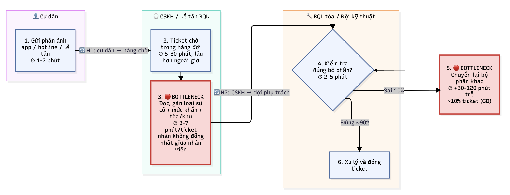

# 🏗️ Phase 3 — DEEP-DIVE (Nhóm, 85 min)

## 3.1. Current-State Workflow Mapping (25 min)
**Vẽ quy trình hiện tại lên bảng/giấy A3.** Sử dụng các ký hiệu:
* 🔴 **Bottleneck:** Bước gây tắc nghẽn, tốn thời gian, hoặc sai sót nhiều nhất.
* 🔄 **Handoff:** Điểm chuyển giao thông tin giữa người và hệ thống, hoặc giữa các bộ phận.
* Ghi rõ thời gian vận hành trung bình: **Tổng cộng = ____ phút/lượt**.

## 3.2. Problem Statement (6-field) & Metrics (15 min)
Điền đầy đủ 6 trường thông tin của bài toán:

| Field | Nội dung chi tiết |
|---|---|
| **1. Actor / Operator** | Nhân viên CSKH, lễ tân, ban quản lý. |
| **2. Current Workflow** | Cư dân gửi phản ảnh bằng text hoặc image qua App Residents, bộ phận quản lý khách hàng sẽ đọc từng ticket một và gán nhãn sự cố nào, mức độ nghiêm trọng, toà nhà nào rồi chuyển cho đội quản lý lĩnh vực đó tiếp nhận và giải quyết vấn đề. |
| **3. Bottleneck** | Chậm ở bước nhân viên gán nhãn bằng tay cho các ticket, các nhân viên khác nhau có thể gán nhãn khác nhau cho cùng 1 ticket. Các ticket có thể mất nhiều thời gian xử lý nếu có quá nhiều ticket trong 1 thời điểm và ngoài giờ làm việc. |
| **4. Business Impact** | 1 năm khoảng 200k ticket mà mỗi ticket có thể mất tới 10p để xử lý, ~33k giờ/năm, ~16-20 FTE, ~ 3-5 tỷ VND/năm. Tác động sửa chữa khẩn đắt hơn bảo trì dự phòng là giá trị phụ. |
| **5. Success Metric** | Tỷ lệ chuyển nhầm từ baseline xuống <3%; time-to-assign từ ~10-40 phút xuống <2 phút cho ≥85% ticket; time-to-resolution giảm so với baseline (đo trước/sau, cùng loại sự cố); reopen rate không tăng. An toàn: recall ca khẩn cấp ≥99% (đo riêng). Mô hình: accuracy ≥90% trên tập giữ lại có nhãn đã kiểm. Chi phí: chi phí/ticket (inference + giám sát) thấp hơn rõ rệt so với gán tay. |
| **6. Operational Boundary** | Gợi ý loại sự cố, mức khẩn cấp, tòa/khu, đội phụ trách. Tự điều hướng ticket khi rule hoặc confidence đủ cao. Tuyệt đối không tự đóng ticket; trả lời cư dân cam kết thời gian, bồi thường, miễn giảm phí; xử lý tranh chấp phí quản lý/pháp lý; hạ mức khẩn do rule đã gắn; gửi dữ liệu cá nhân chưa ẩn danh ra ngoài hạ tầng đã được duyệt. Cần Human-in-the-loop: confidence thấp, ticket nhiều sự cố, nội dung tranh chấp/pháp lý, ca mà AI và rule bất đồng. |

## 3.3. Future-State Flow & AI Fit (25 min)
* **Xác định mức AI Fit (AI-Fit Matrix):** Giải pháp thuộc nhóm nào? [X] Rule / State-Machine [X] LLM Feature [ ] Agentic Loop.
* **Vẽ Future-State Flow:** Đánh dấu rõ:
  * 🔵 **AI Step:** Tác vụ LLM xử lý.
  * 🟢 **Human Step (HITL):** Bước con người phê duyệt/review (Human-in-the-loop).
  * ↩️ **Fallback:** Kế hoạch dự phòng khi LLM trả về kết quả lỗi hoặc không tự tin.

---

# 🏁 Phase 5 — EVALUATE (Nhóm, 20 min)

### AI Readiness Checklist:
1. [ ] Chúng tôi có sẵn dữ liệu mẫu/logs sạch để test?
2. [X] Rủi ro khi AI sai có nằm trong tầm kiểm soát (qua HITL hoặc Fallback)?
3. [ ] Stakeholders sẵn sàng thay đổi quy trình làm việc cũ?

### Quyết định cuối cùng của Ban Giám Đốc Vin Smart Future:
[X] **NOT YET (Cần tích lũy thêm dữ liệu/xác lập baseline):** Chưa triển khai AI vào quy trình thật; trước tiên xác nhận dữ liệu và baseline, sau đó mới chạy pilot có người duyệt.
[ ] **NO-GO (Không khả thi / Rule-based tốt hơn):** Hủy bỏ dự án AI này.

**Justification (Lý giải quyết định dựa trên bằng chứng kỹ thuật và chi phí):**
> Bài toán có tiềm năng vì phân loại và định tuyến ticket lặp lại, còn LLM có thể hỗ trợ hiểu phản ánh tự do bằng văn bản. Tuy nhiên, báo cáo hiện chưa xác nhận có tập ticket lịch sử sạch, đã ẩn danh và được gán nhãn để đánh giá; mức sẵn sàng của CSKH/ban quản lý cũng chưa được kiểm chứng. Các con số về số lượng ticket, thời gian xử lý và chi phí ở phần Problem Statement hiện là ước tính, cần đối chiếu với log vận hành và baseline thực tế trước khi dùng để kết luận hiệu quả hay ROI.
>
> Vì vậy chọn **NOT YET**, không phải NO-GO: rủi ro có thể giới hạn trong pilot bằng cách để AI chỉ đề xuất, yêu cầu người duyệt cho ca rủi ro cao/độ tin cậy thấp, và giữ fallback về quy trình phân loại thủ công. Trước khi quyết định GO, nhóm cần (1) xác nhận quyền truy cập và chất lượng dữ liệu đã ẩn danh, (2) đo baseline theo loại sự cố gồm thời gian tiếp nhận/định tuyến, tỷ lệ chuyển nhầm và tỷ lệ ticket khẩn bị bỏ sót, (3) thử nghiệm offline trên tập dữ liệu được người phụ trách kiểm nhãn, rồi (4) chạy pilot giới hạn có HITL. Chỉ mở rộng nếu đạt các ngưỡng đã đề xuất ở phần Success Metric — đặc biệt recall ca khẩn cấp ≥99% và tỷ lệ chuyển nhầm <3% — mà không làm tăng tỷ lệ mở lại ticket; đồng thời cần xác nhận mức giảm thời gian và chi phí bằng số liệu pilot.