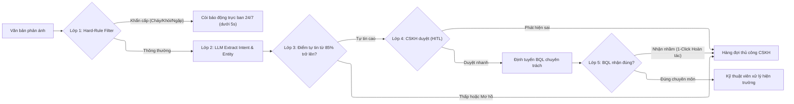

# 02 — Problem Deep-Dive Report: Vinhomes Smart Resident Feedback Routing

> **Tài liệu nộp bài Lab 02 (Phần A — Báo cáo phân tích chuyên sâu)**  
> **Đơn vị công nghệ:** Vin Smart Future (Tập đoàn Vingroup)  
> **Đơn vị thụ hưởng:** Công ty Cổ phần Vinhomes (Khối Quản lý & Vận hành Đô thị)  
> **Bài toán:** Phân loại đa nhãn và định tuyến tự động phản ánh của cư dân trên ứng dụng Vinhomes Resident.

---

## 🏛️ 1. Bối Cảnh Thực Tế & Vai Trò Vận Hành

- **Người thực hiện:** AI Product Engineering Team, Vin Smart Future.
- **Bối cảnh vận hành:** Công ty Cổ phần Vinhomes hiện quản lý và vận hành trên **110.000 căn hộ, biệt thự và shophouse** với quy mô dân số phục vụ đạt **gần 493.000 cư dân** (đang mở rộng lên 650.000 cư dân khi hoàn tất bàn giao các đại đô thị Vinhomes Ocean Park 1, 2, 3, Vinhomes Smart City và Vinhomes Grand Park).
- **Quy mô nghiệp vụ:** Trung tâm Chăm sóc khách hàng (CSKH) trung tâm tiếp nhận trung bình từ **1.100 đến 1.800 phản ánh/khiếu nại mỗi ngày** qua ứng dụng Vinhomes Resident (dao động từ 1,0% đến 1,6% số căn hộ/ngày).
- **Vấn đề cốt lõi:** Việc tiếp nhận, đọc hiểu nội dung tự do không cấu trúc và phân loại thủ công vào hơn 30 danh mục phòng ban chuyên trách đang tạo ra điểm nghẽn nghiêm trọng tại tổng đài CSKH trung tâm, gây kéo dài thời gian phản hồi (SLA từ 4–12 giờ) và chiếm dụng hơn 300 giờ làm việc thủ công mỗi ngày.

---

## ⏱️ 2. Phase 3.1 — Current-State Workflow Mapping (Quy trình hiện tại)

### 2.1. Sơ đồ quy trình vận hành thủ công 4 bước:

```text
┌─────────────────┐       ┌─────────────────┐       ┌─────────────────┐       ┌─────────────────┐
│ Bước 1          │       │ Bước 2          │       │ Bước 3          │       │ Bước 4          │
│ Tiếp nhận       │  ──→  │ Tra cứu CSDL    │  ──→  │ Đọc hiểu ngữ    │  ──→  │ Tạo ticket &    │
│ phản ánh App    │       │ căn hộ & tòa    │       │ cảnh & phân loại│       │ gửi BQL tòa     │
│                 │       │                 │       │                 │       │                 │
│ Ai: Hệ thống App│       │ Ai: CSKH viên   │       │ Ai: CSKH viên   │       │ Ai: CSKH viên   │
│ ⏱ 0.5 phút      │       │ ⏱ 2-3 phút      │       │ ⏱ 5-8 phút 🔴   │       │ ⏱ 2-4 phút      │
│ In: Raw text    │       │ In: Mã tài khoản│       │ In: Nội dung    │       │ In: Danh mục    │
│ Out: Ticket thô │       │ Out: Tòa/Tầng/Căn│      │ Out: Mã ban vụ  │       │ Out: Ticket BQL │
└─────────────────┘       └─────────────────┘       └─────────────────┘       └─────────────────┘
```

- 🔴 **Điểm nghẽn cổ chai (Bottlenecks):**
  - **Bước 3 (Đọc hiểu & Phân loại nghiệp vụ):** Mất 5–8 phút/ticket do văn bản của cư dân thường dài dòng, lẫn lộn nhiều cảm xúc, sử dụng từ lóng hoặc mô tả không rõ ràng, đòi hỏi nhân viên phải suy luận ngữ cảnh để chọn đúng 1 trong hơn 30 danh mục (điện, nước, thang máy, vệ sinh, cây xanh, an ninh, kế toán phí...).
  - **Bước 4 (Khởi tạo & Định tuyến thủ công):** Mất 2–4 phút/ticket để sao chép thông tin, chọn đúng hòm thư tiếp nhận của Ban Quản lý (BQL) tòa nhà trực thuộc dự án.
- 🔄 **Điểm chuyển giao (Handoffs):**
  - **Handoff 1 (Cư dân $\to$ CSKH Trung tâm):** Qua giao diện ứng dụng Vinhomes Resident.
  - **Handoff 2 (CSKH Trung tâm $\to$ BQL Tòa nhà/Kỹ thuật):** Qua phần mềm quản lý vận hành nội bộ (ERP/CRM).
- ⏱ **Thời gian xử lý trung bình:** **10–12 phút/ticket** (tổng thời gian lãng phí từ 183 đến 300 giờ làm việc/ngày trên toàn hệ thống).

---

## 📋 3. Phase 3.2 — Problem Statement (6-Field) — Chuẩn Vin Smart Future

| Trường thông tin | Nội dung chi tiết |
| :--- | :--- |
| **1. Actor / Operator** | Nhân viên Chăm sóc khách hàng (CSKH) tổng đài trung tâm và Ban Quản lý (BQL) các khu đô thị Vinhomes. |
| **2. Current Workflow** | Cư dân gửi phản ánh tự do trên App $\to$ CSKH đọc thủ công $\to$ Tra cứu thông tin căn hộ $\to$ Đọc hiểu ngữ cảnh để phân loại vào danh mục phòng ban $\to$ Khởi tạo ticket và chuyển tiếp đến BQL tòa nhà phụ trách. |
| **3. Bottleneck** | Bước phân loại nghiệp vụ và trích xuất thực thể từ văn bản tự do của cư dân (dễ phân loại nhầm danh mục, nhập liệu chậm, mất nhiều thời gian đọc hiểu văn bản dài). |
| **4. Business Impact** | Quá tải tổng đài viên (lãng phí 183 – 300 giờ làm việc/ngày, tương đương chi phí nhân sự cơ học từ 4,12 đến 6,75 tỷ VNĐ/năm); thời gian phản hồi ban đầu cho cư dân bị kéo dài (SLA 4–12 giờ); tỷ lệ gửi nhầm phòng ban chiếm ~15% dẫn đến chuyển tiếp lòng vòng, làm giảm chỉ số hài lòng cư dân (CSAT). |
| **5. Success Metric** | 1. Giảm thời gian phân loại và tạo ticket từ 12 phút xuống dưới 1 phút/ticket (tiết kiệm $\ge 90\%$ thời gian).<br>2. Cắt giảm chi phí nhân sự từ 4,12 đến 6,75 tỷ VNĐ/năm (giải phóng từ 22,9 đến 37,5 nhân sự FTE).<br>3. Tỷ lệ định tuyến chính xác đến đúng BQL đạt tối thiểu 92% ngay lần đầu.<br>4. 100% tình huống khẩn cấp (cháy nổ, ngập nước, chập điện) được phát hiện và kích hoạt chuông cảnh báo trực ban dưới 5 giây. |
| **6. Operational Boundary** | **ĐƯỢC PHÉP:** Trích xuất thực thể (vị trí, thiết bị, loại sự cố), gán nhãn danh mục phòng ban, đánh giá mức độ khẩn cấp, khởi tạo bản thảo ticket nội bộ có gắn nhãn `[DRAFT_ONLY]`.<br>**CẤM:** Tuyệt đối không tự ý gửi tin nhắn phản hồi cam kết ra ngoài cho cư dân; không tự ý kết luận bồi thường hoặc đưa ra quan điểm pháp lý; không tự động đóng ticket khi chưa có kỹ thuật viên hiện trường nghiệm thu. |

---

## 🧠 4. Phase 3.3 — Future-State Flow & AI Fit

### 4.1. AI-Fit Matrix: So sánh lựa chọn kiến trúc kỹ thuật

- **No AI / Pure Rule-based:** Không khả thi vì cư dân nhập văn bản tự nhiên tự do, đa dạng phương ngữ, viết tắt và dùng nhiều cách diễn đạt khác nhau; bộ lọc từ khóa tĩnh (Keyword Search) sẽ bỏ sót lỗi ngữ cảnh hoặc nhận diện sai intent nghiêm trọng.
- **Agentic Loop (Multi-Agent tự trị hoàn toàn):** Không phù hợp do tính chất phức tạp không cần thiết; việc trao quyền cho các agent tự thương lượng và tự dispatch có nguy cơ gây vòng lặp vô tận (infinite loop), khó kiểm soát chi phí API và tiềm ẩn nguy cơ ảo giác vượt quyền gây khiếu nại pháp lý.
- **Lựa chọn tối ưu: LLM Feature kết hợp Rule-based Router (Hybrid Architecture):**
  - **Mô hình LLM (Gemini 3.1 Flash Lite):** Đóng vai trò bộ trích xuất thông tin (Information Extractor), đọc hiểu văn bản tự nhiên của cư dân và chuẩn hóa thành payload JSON cấu trúc gồm: `intent`, `category`, `building_id`, `apartment_id`, `urgency_level` (`EMERGENCY` / `NORMAL`), và `confidence_score`.
  - **Hệ thống Rule Router:** Đảm nhận việc tiếp nhận JSON có cấu trúc để tra cứu ma trận phân quyền quản lý và tự động định tuyến ticket đến đúng tài khoản BQL tòa nhà phụ trách mà không cần con người can thiệp vào khâu nhập liệu.

### 4.2. Future-State Workflow (Quy trình tương lai có AI)

```text
┌─────────────────┐       ┌─────────────────┐       ┌─────────────────┐       ┌─────────────────┐
│ Bước 1          │       │ Bước 2          │       │ Bước 3          │       │ Bước 4          │
│ Cư dân gửi      │  ──→  │ 🔵 AI Parse     │  ──→  │ 🔵 Rule Router  │  ──→  │ 🟢 CSKH / BQL   │
│ phản ánh App    │       │ Intent & Entity │       │ phân luồng BQL  │       │ 1-click duyệt   │
│                 │       │ (JSON Output)   │       │ tự động         │       │ phát lệnh đi    │
└─────────────────┘       └─────────────────┘       └─────────────────┘       └─────────────────┘
                                   │                                                   │
                                   ▼ (Nếu Confidence < 85% hoặc Emergency)             ▼
                        ┌────────────────────────┐                             ↩️ Fallback:
                        │ 🟢 Human Queue         │                             Nếu BQL nhận nhầm,
                        │ Chuyển CSKH phân loại  │                             1-click trả lại
                        │ thủ công tức thì       │                             hàng đợi tổng.
                        └────────────────────────┘
```

---

## 🛡️ 5. Quản Trị Rủi Ro: Nếu AI Làm Sai, Cơ Chế Phòng Ngừa 5 Lớp & Ma Trận Trách Nhiệm RACI

Trong môi trường vận hành đại đô thị, sự cố AI dự đoán sai là điều không thể tránh khỏi ở một tỷ lệ nhất định. Do đó, hệ thống được thiết kế với tư duy phòng vệ đa tầng và quy chế trách nhiệm con người rõ ràng.

### 5.1. Bốn Kịch Bản Lỗi Khi AI Làm Sai & Hậu Quả Cụ Thể

1. **Phân loại sai phòng ban (Misclassification / False Routing):** Cư dân báo hỏng khóa từ cửa chính (thuộc bộ phận Kỹ thuật điện), AI phân loại nhầm sang Vệ sinh môi trường $\to$ *Hậu quả:* BQL xử lý chậm trễ, các bộ phận đùn đẩy trách nhiệm nội bộ.
2. **Bỏ sót tình huống khẩn cấp (False Negative on Emergency):** Cư dân báo mùi khét chập tủ điện hành lang, AI hiểu nhầm là mùi rác sinh hoạt và xếp hàng xử lý thông thường $\to$ *Hậu quả nghiêm trọng:* Chậm trễ ứng cứu sự cố cháy nổ đe dọa an toàn cư dân.
3. **Trích xuất sai căn hộ / tòa nhà (Entity Hallucination):** Căn hộ S2.01-1204 bị AI trích xuất nhầm thành S2.02-1402 $\to$ *Hậu quả:* Kỹ thuật viên đến gõ cửa nhầm nhà, gây phiền toái cho cư dân khác và kéo dài thời gian xử lý sự cố gốc.
4. **Tự ý đưa ra phát ngôn hoặc cam kết sai thẩm quyền (Unauthorized Commitments):** AI tự động sinh câu trả lời hứa hẹn bồi thường thiệt hại hoặc kết luận lỗi thuộc về BQL $\to$ *Hậu quả:* Rủi ro tranh chấp pháp lý và thiệt hại tài chính cho Vinhomes.

---

### 5.2. Hệ Thống Phòng Ngừa Kỹ Thuật 5 Lớp (5-Layer Defense System)



**Sơ đồ luồng xử lý dạng khối (ASCII Flowchart):**

```text
[Cư dân gửi phản ánh] 
         │
         ▼
{Lớp 1: Hard-Rule Filter} ──(Khẩn cấp: Cháy/Khói/Ngập)──→ [Còi báo động trực ban 24/7]
         │
         │ (Thông thường)
         ▼
[Lớp 2: LLM Extract Intent & Entity]
         │
         ▼
{Lớp 3: Điểm tự tin >= 0.85?} ──(Thấp / Mơ hồ)──────────┐
         │                                               │
         │ (Tự tin cao)                                  │
         ▼                                               │
{Lớp 4: CSKH duyệt (HITL)} ──(Phát hiện sai)─────────────┤
         │                                               │
         │ (Duyệt nhanh)                                 │
         ▼                                               │
[Định tuyến BQL chuyên trách]                            │
         │                                               │
         ▼                                               │
{Lớp 5: BQL nhận đúng?}                                  │
         │                                               │
         ├─(Đúng chuyên môn)──→ [Kỹ thuật viên xử lý]    │
         │                                               │
         └─(Nhận nhầm: 1-Click Hoàn tác)─────────────────┴──→ [Hàng đợi thủ công CSKH]
```

1. **Lớp 1 — Ngắt mạch khẩn cấp bằng Hard Rules (Emergency Circuit Breaker):** Tại tầng API Gateway, văn bản được quét qua bảng từ khóa cứng (Regex/Trie Matching) với các từ khóa sinh mạng/cháy nổ: `cháy`, `khói`, `chập điện`, `khí gas`, `vỡ đường ống nước`, `kẹt thang máy`. Bất kỳ phát hiện nào lập tức kích hoạt chuông cảnh báo tại phòng trực an ninh 24/7 dưới 5 giây mà không phụ thuộc vào LLM.
2. **Lớp 2 — Rào chắn cấm phát ngôn độc lập (No Autonomous Outer Speech):** Cắt bỏ hoàn toàn quyền phát ngôn ra bên ngoài của mô hình. Đầu ra của LLM 100% chỉ là dữ liệu nội bộ phục vụ tạo ticket nháp (`[DRAFT_ONLY]`), ngăn chặn tuyệt đối rủi ro phát ngôn sai thẩm quyền.
3. **Lớp 3 — Ngưỡng kiểm định tự tin (Confidence Score Threshold Gate):** Khi mô hình trả về trường `confidence_score < 0.85`, hệ thống không tự động phân luồng mà đưa ticket vào hàng đợi `AMBIGUOUS_MANUAL_QUEUE` để nhân viên CSKH trực tiếp đọc và phân loại.
4. **Lớp 4 — Phê duyệt có con người kiểm soát (Human-in-the-loop Gate):** Nhân viên CSKH chỉ cần 3 giây để nhìn nhanh bản thảo do AI điền sẵn và bấm nút "Xác nhận duyệt" hoặc chọn lại danh mục nếu phát hiện sai lệch.
5. **Lớp 5 — Cơ chế hoàn tác 1-Click (1-Click Reverse Routing Fallback):** Nếu một ticket bị phân loại sai lọt qua vòng duyệt đến BQL tòa nhà, kỹ thuật viên chỉ cần bấm nút *"1-Click Trả lại"*. Ticket lập tức được chuyển về hàng đợi ưu tiên cao của tổng đài CSKH trong vòng 30 giây để điều chỉnh, không bắt cư dân phải tạo lại phản ánh.

---

### 5.3. Ma Trận Phân Định Trách Nhiệm (RACI Accountability Matrix)

Nguyên tắc pháp lý: **AI không phải là pháp nhân, AI không chịu trách nhiệm trước pháp luật hay nội quy doanh nghiệp. Mọi trách nhiệm đều gắn liền với con người.**

| Vai trò / Bộ phận | Trách nhiệm RACI | Phạm vi chịu trách nhiệm cụ thể khi xảy ra lỗi |
| :--- | :---: | :--- |
| **Nhân viên CSKH trực ca (Human-in-the-loop)** | **R (Responsible)** | Chịu trách nhiệm trực tiếp về việc kiểm tra và bấm nút duyệt gửi ticket. Nếu AI phân loại sai hiển nhiên (ví dụ phản ánh rò nước nhưng AI gán an ninh) mà nhân viên vẫn bấm duyệt mà không sửa thì nhân viên chịu lỗi vi phạm quy trình nghiệp vụ CSKH. |
| **Trưởng ca trực CSKH / Quản lý Tổng đài** | **A (Accountable)** | Chịu trách nhiệm giải trình toàn diện về cam kết thời gian tiếp nhận (SLA), giám sát hàng đợi xử lý thủ công không bị dồn ứ và trực tiếp xử lý các khiếu nại bức xúc leo thang. |
| **Trưởng Ban Quản lý (BQL) khu đô thị** | **A (Accountable)** | Chịu trách nhiệm về chất lượng xử lý sự cố tại hiện trường và việc phát hiện phản ánh gửi nhầm để bấm nút hoàn tác 1-Click kịp thời. |
| **Đội ngũ AI Engineer (Vin Smart Future)** | **S (Support / Technical Owner)** | Chịu trách nhiệm về tính sẵn sàng kỹ thuật của hệ thống (Uptime $\ge 99,5\%$), duy trì độ chính xác mô hình (Accuracy benchmark $\ge 92\%$), và thực hiện vá lỗi/retrain mô hình định kỳ khi phát hiện tỷ lệ phân loại sai tăng đột biến. |

---

## 🧪 6. Phân Tích Kịch Bản Biên & Thử Nghiệm Đối Kháng (Edge Cases & Defenses)

| # | Kịch bản biên thực tế | Nguy cơ rủi ro | Cơ chế phòng thủ kỹ thuật |
| :--- | :--- | :--- | :--- |
| **EC1** | **Báo động khẩn cấp (Emergency)**: Cư dân nhắn: *"Chập điện tủ điện tầng 12 khói mù mịt, thang máy đang kẹt người!"* | Xếp hàng phân loại LLM thông thường có thể gây trễ 10–30s dẫn đến hậu quả nghiêm trọng. | **Emergency Bypass Rule**: Regex phát hiện từ khóa `chập điện`, `khói`, `kẹt` $\to$ Bắn thông báo khẩn cấp sang cổng bộ đàm an ninh/kỹ thuật trực ban 24/7 trong vòng 3 giây. |
| **EC2** | **Tranh chấp pháp lý / Đơn thư bức xúc**: Cư dân dọa kiện ban quản lý ra tòa vì chậm giải quyết phí bảo trì. | AI tự động trả lời xoa dịu rập khuôn gây phản tác dụng và phát sinh rủi ro pháp lý. | **Legal Gate & Draft Only**: Phân loại vào nhóm `LEGAL_RISK`, khóa chức năng tự động phản hồi, chuyển thẳng ticket về hòm thư Trưởng BQL kèm toàn bộ hồ sơ căn hộ. |
| **EC3** | **Phản ánh đa nội dung (Multi-Intent)**: *"Thang máy kêu cọt kẹt, hành lang rác bẩn chưa dọn, bảo vệ tầng hầm thái độ kém."* | Phân loại đơn nhãn sẽ bỏ sót 2 vấn đề còn lại, gây đùn đẩy trách nhiệm. | **Multi-Entity Parsing**: LLM trích xuất mảng danh mục `[technical, sanitation, security]`, tự động nhân bản thành 3 sub-tickets liên kết chung 1 mã vụ việc để 3 bộ phận cùng xử lý song song. |
| **EC4** | **Teencode, viết tắt, ảnh mờ**: *"hlang mùi kinh khủng k chịu đc"* hoặc chỉ gửi ảnh chụp rò nước không kèm chữ. | LLM suy diễn sai lệch (hallucination) do dữ liệu đầu vào thiếu thông tin. | **Confidence Score Threshold**: Điểm tự tin $< 0.85 \to$ Tự động chuyển ticket sang hàng đợi `UNRESOLVED_MANUAL` để nhân viên CSKH gọi điện xác minh trực tiếp. |
| **EC5** | **Sự cố hệ thống quá tải / Rớt API**: Đứt cáp mạng hoặc API LLM phản hồi mã lỗi 503. | Toàn bộ quy trình tiếp nhận của cư dân bị gián đoạn, tê liệt ban quản lý. | **Graceful Degradation**: Tự động chuyển luồng tiếp nhận về chế độ lưu trữ Message Queue (RabbitMQ/Kafka) và kích hoạt giao diện phân loại thủ công cổ điển, đảm bảo không rơi rụng bất kỳ ticket nào của cư dân. |

---

## 🏁 7. Phase 5 — EVALUATE & Quyết Định Đầu Tư

### 7.1. Bảng Kiểm Tra Sẵn Sàng Ứng Dụng AI (AI Readiness Checklist)

1. **[x] Tính sẵn sàng của dữ liệu (Data Readiness):** Hệ thống CRM của Vinhomes lưu trữ hàng triệu ticket phản ánh lịch sử có gắn nhãn giải quyết, cung cấp tập dữ liệu mẫu chuẩn để đánh giá và đo lường benchmark.
2. **[x] Khả năng kiểm soát rủi ro an toàn (Risk Control):** Có hệ thống phòng thủ 5 lớp, cơ chế ngắt mạch khẩn cấp bằng Hard Rules, Human-in-the-loop phê duyệt và cơ chế hoàn tác 1-Click.
3. **[x] Mức độ sẵn sàng của các bên liên quan (Stakeholder Buy-in):** Ban Quản lý các khu đô thị đang chịu áp lực lớn về nhân sự và SLA thời gian thực, hoàn toàn ủng hộ việc tự động hóa khâu tiền xử lý ticket.

### 7.2. Quyết Định Đầu Tư Của Ban Giám Đốc Vin Smart Future

- [x] **GO (Bắt đầu xây dựng Prototype):** Dự án có tính khả thi kỹ thuật cao, ranh giới an toàn cơ học rõ ràng, và mang lại giá trị giải phóng năng suất đo đạc được bằng số liệu thực tế.

### 7.3. Luận Cứ Kinh Tế & An Toàn (Investment Justification)
- **Hiệu quả tài chính & thời gian:** Tiết kiệm từ **48.391 đến 79.200 giờ làm việc mỗi năm**, giải phóng từ **22,9 đến 37,5 nhân sự FTE**, mang lại giá trị tiết kiệm tiền mặt trực tiếp từ **4,12 đến 6,75 tỷ VNĐ/năm**.
- **An toàn vận hành tuyệt đối:** Mô hình hoạt động theo nguyên tắc Co-pilot hỗ trợ nội bộ, không tự động phát ngôn ra bên ngoài, có rào chắn cứng cho sự cố khẩn cấp và ma trận phân định trách nhiệm con người (RACI) minh bạch.
